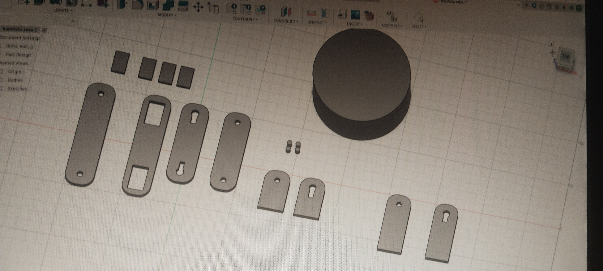

# Arm controled by a glove

# Arm Controlled by a Glove

This project is created as part of the Hack Club: Half Life challenge. The main goal is to build a 3D printable robotic arm controlled by a glove equipped with flex sensors.

---

## Repository Contents

* `.f3d` – Source CAD models designed in Autodesk Fusion.

* `.stl` – Ready-to-print 3D files.

---

## 3D Printing Settings

* **Infill:** 15% - 20%

* **Layer Height:** 0.2 mm

* **Supports:** Required for overhangs and joints.

---

## Bill of Materials

* 5x Flex sensors (for finger movement detection)

* 5x SG90 Micro servo motors (for driving the arm joints)

* 3D printed mechanical parts

